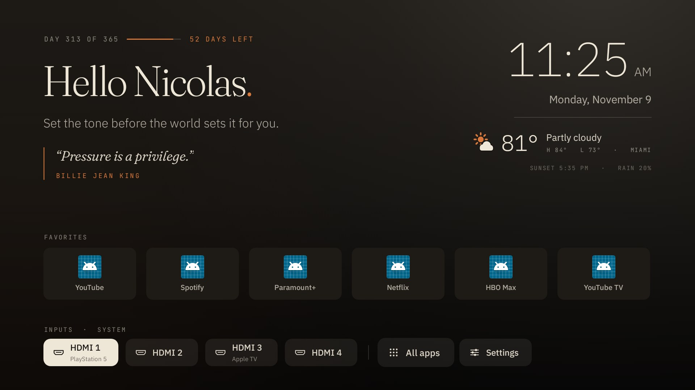
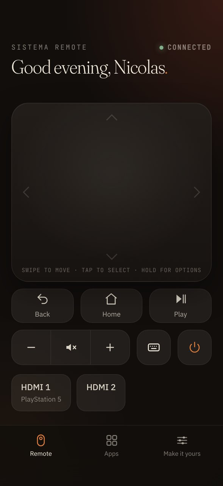
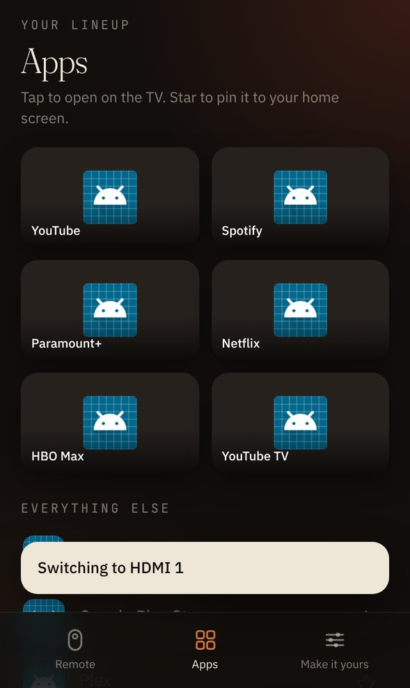
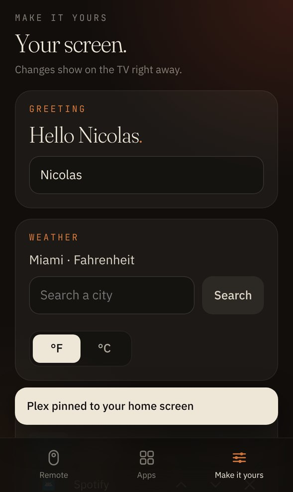

# Sistema Home

Your Google TV, stripped down to what matters.

Hello Nicolas. The time. Today's Miami weather. A quote dealt fresh every time the TV wakes up. Your six apps and your HDMI ports. Nothing else. No sponsored rows, no "top picks for you", no ads.

Plus a remote for your iPhone that the TV hosts itself. Jump to [Phone remote](#phone-remote-iphone).



The design is SISTEMA's own system, flipped dark for a room at night: Fraunces for the greeting and quotes, a clean sans for the clock, mono for the small labels, paper on ink, terracotta accents. The background follows the real sun. It glows warm at sunrise, stays soft through the day, turns terracotta at golden hour and goes deep after dark.

## Setup (once, about 10 minutes)

**On the TV**

1. Settings > System > About. Scroll to **Android TV OS build** and press OK 7 times until it says you're a developer.
2. Settings > System > Developer options. Turn on **USB debugging** (and **Network debugging** if your TV shows it).

**On your Windows PC** (same Wi-Fi as the TV)

1. Download the project: [sistema ZIP](https://github.com/n8martins/sistema/archive/refs/heads/claude/google-tv-custom-launcher-wi3l8c.zip)
2. Right-click the ZIP > **Extract All** > **Extract**.
3. Open the extracted folder, then the **tv** folder.
4. Double-click **Setup-Windows.cmd**. If Windows warns you, click **More info** > **Run anyway** (or **Run**).

The first run downloads Google's adb tool by itself. Nothing else to install.

**On a Mac or Linux** (same Wi-Fi as the TV)

```bash
brew install android-platform-tools      # gives you adb (Linux: sudo apt install adb)
git clone -b claude/google-tv-custom-launcher-wi3l8c https://github.com/n8martins/sistema.git
cd sistema/tv
./setup.sh                               # uses 192.168.4.40 by default
```

**Then, on the TV:** when it asks **Allow USB debugging?**, tick **Always allow from this computer** and press **Allow**.

That's it. Press Home on the remote.

## What setup does

1. Installs Sistema Home and opens it.
2. **Checks it's actually running.** If it isn't, it stops right there and changes nothing else.
3. Unlocks the phone remote. The TV asks once to allow debugging for Sistema itself.
4. Makes it your home screen and turns off the stock Google TV home.
5. Shows you the bloat it found and asks before turning it off:

| Package | What it is |
| --- | --- |
| `com.google.android.tvrecommendations` | Sponsored rows and the recommendation feed |
| `com.google.android.videos` | Google TV movie store |
| `com.google.android.youtube.tvmusic` | YouTube Music (you're on Spotify) |
| `com.google.android.youtube.tvkids` | YouTube Kids |
| `com.google.android.play.games` | Play Games |
| `com.google.android.feedback` | Feedback reporter |
| `com.android.printspooler` | Printing |
| `tv.pluto.android`, `com.tubitv` | Preloaded free TV apps |

Add `--ambient` to also kill Google's Ambient Mode screensaver.

**Never touched:** Play Store, Play Services, Chromecast built-in, Google Assistant and voice search, the remote service, TV settings, and the TV's own input and tuner apps. Casting from your phone and the mic button keep working.

Nothing is deleted. Everything is *disabled*, and a snapshot of every package on the TV is saved in `tv/backups/` first.

## Using it

* **OK** opens an app.
* **Hold OK** (or press **Menu**) on a favorite to move it left or right, remove it, or open its app info.
* **All apps** shows everything installed. Hold OK on any app to pin it to Favorites.
* **Inputs** switches HDMI ports directly. If a console or box is connected over HDMI-CEC, its name shows under the port.
* Go **up** to the quote and press OK for another one. A new quote is dealt every time the TV wakes, and nothing repeats until you've seen all 45.
* **Back** jumps to your first app.

If one of your six apps isn't installed, its tile says so and opens Google Play.

## Phone remote (iPhone)

  

The TV hosts its own remote. No App Store, no account, nothing in the cloud.

1. On your iPhone, on the same Wi-Fi, open Safari and go to **http://192.168.4.40:8737**
2. Tap **Share** > **Add to Home Screen** > **Add**. It now opens full screen like an app.
3. Open it, tap **Show the code on my TV**, and type the four digits the TV shows.
4. The first time, the TV asks **Allow USB debugging?** for Sistema. Tick **Always allow** and press **Allow**. That's what lets your phone press buttons inside Netflix, YouTube and everything else.

**Remote:** a touchpad like the Apple TV remote. Swipe to move, tap to select, tap an edge to click that direction, hold for options. Back, Home, Play, volume (hold to keep going), mute, turn off, and your HDMI inputs one tap away.

**Keyboard:** type on your phone and it appears in whatever search box is open on the TV.

**Apps:** your favorites with their real banners, plus everything else installed. Tap to open on the TV, star to pin to the home screen.

**Make it yours:**
* Change the greeting name.
* Search any city for the weather, and pick °F or °C.
* Reorder or remove favorites.
* Put a new quote on the TV, or add your own quotes. Yours go straight onto the TV and are signed with your name if you leave the author empty.
* Set a sleep timer: 30 minutes, 1, 1.5 or 2 hours.

Only phones that typed the code can control the TV. "Forget this phone" in Make it yours revokes it. If your TV's address changes, use the new one shown in small text under the weather on the TV until a phone is paired.

## Make it yours over ADB

Change the name, city, weather location, units or favorites without rebuilding:

```bash
adb -s 192.168.4.40:5555 shell am start -n com.sistema.home/.HomeActivity --es city Brickell --es lat 25.7617 --es lon -80.1918 --es units f
```

On Windows, open PowerShell in the tv folder and start the line with `tools\platform-tools\adb.exe` instead of `adb`.

`--es favorites "com.netflix.ninja,com.google.android.youtube.tv"` sets the favorites row in one shot. Package names are in `setup.sh`.

## Undo

Windows: double-click **Restore-Windows.cmd** in the tv folder.

Mac or Linux:

```bash
./restore.sh                 # everything back on, Sistema removed
./restore.sh --keep-app      # Google TV home back, Sistema stays installed
```

On Windows, keep the app with `Restore-Windows.cmd -KeepApp` from a Command Prompt in the tv folder.

## Good to know

* A big TV software update can switch the stock launcher back on. Run `./setup.sh` again. It's safe to run as many times as you want.
* Holding Home for the Google TV dashboard is part of the stock launcher, so that shortcut goes away. Settings is one press away in the bottom row.
* Weather comes from Open-Meteo. Free, no account, no API key.
* If the TV only offers **Wireless debugging** with a pairing code, run `adb pair 192.168.4.40:<pairing port>`, type the code, then `./setup.sh 192.168.4.40:<port>` with the port shown on that screen.

## Under the hood

* `launcher/` is a standard Android project (Java, no dependencies). Open it in Android Studio or run `./gradlew assembleDebug`.
* `launcher/app/src/test/` boots the real launcher on Robolectric at 1920x1080, drives it like a remote, checks focus, the options sheet, HDMI switching and the weather parser, and renders the screenshots in `preview/`. It also runs the phone remote's API over real HTTP: pairing, security, settings, favorites, quotes, icons and the sleep timer.
* The phone remote lives in `launcher/app/src/main/assets/remote/` (the page) and `RemoteServer.java` (the API on port 8737). `AdbClient.java` talks to the TV's own debugging service so keys work inside every app. `tools/fake_adbd.py` stands in for that service in tests and checks the key format and signatures the way the real one does.
* `dist/sistema-home.apk` is the prebuilt APK that `setup.sh` installs. `tools/build-apk.sh` rebuilds it without Android Studio.
* GitHub Actions (`.github/workflows/tv-launcher.yml`) runs the tests and builds the APK on every change to `tv/`.
